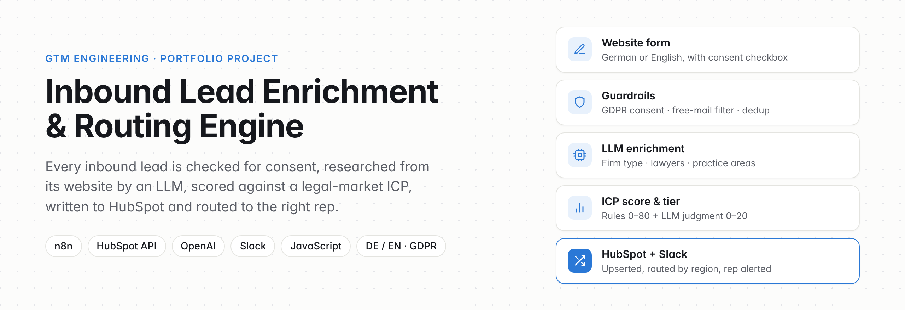
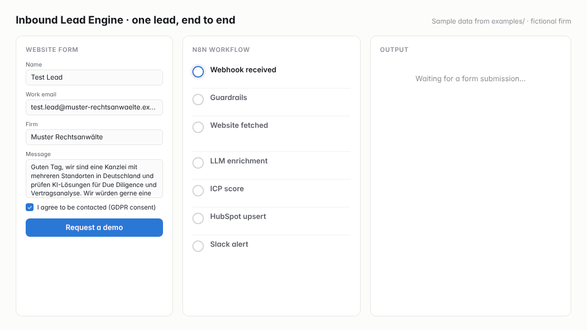
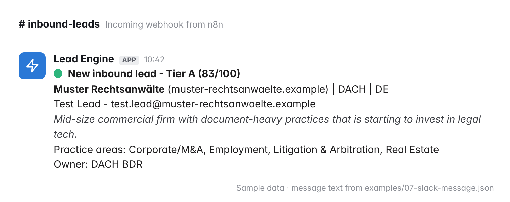
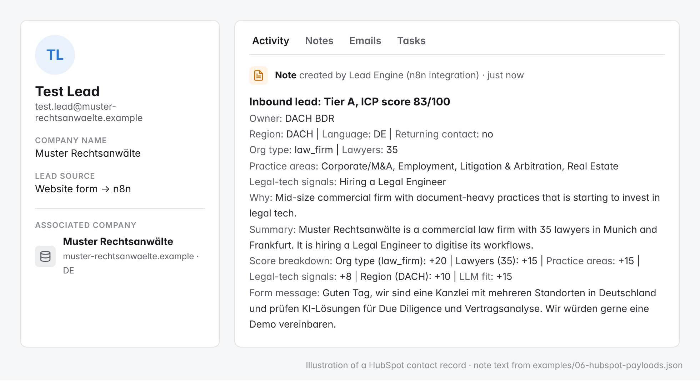
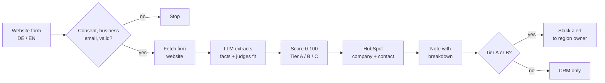
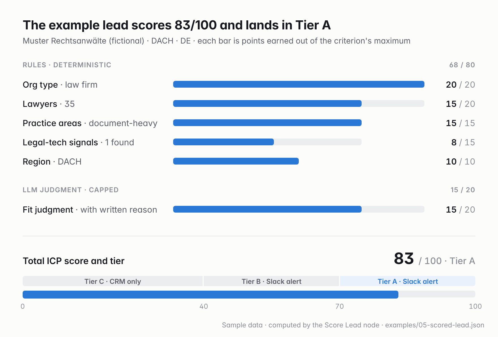

<p align="center">
  
</p>

<p align="center">
  <a href="https://github.com/anat100/Lead-enrichment-and-routing-engine/actions/workflows/test.yml"></a>
  
  
  
  
  
</p>

An **n8n workflow that turns a website form submission into a researched, scored and routed lead**. It checks GDPR consent, reads the company's website with an LLM, scores the fit against an ICP for the legal market, writes the company and contact to HubSpot, and alerts the right rep in Slack.

It is designed for a **DACH go-to-market team selling legal AI** to law firms and in-house legal departments: German/English detection, region routing (DACH vs. rest of EU), and data handling that respects GDPR.

<p align="center">
  
  <br><sub>One fictional lead, end to end. Every panel shows real output from the workflow's code (<a href="examples/">examples/</a>).</sub>
</p>

## The problem

Inbound demo requests are the warmest leads a sales team gets, yet they often wait. A rep first has to work out who the firm is, whether it fits, who owns the region, and whether the person is already in the CRM. That research is manual, inconsistent and slow.

This engine does the first pass automatically, in one workflow run:

| Before | After |
| --- | --- |
| A rep opens the firm's website to judge the fit | An LLM extracts firm type, size, practice areas and legal-tech signals |
| Fit is a gut feeling | A 0–100 ICP score with a written reason and a point-by-point breakdown |
| Leads are assigned by whoever sees them first | Routed by region to the owning rep |
| Duplicates appear in the CRM | Contacts upserted by email; companies matched by domain |
| Personal emails and leads without consent slip in | Blocked before any processing |

## What the rep sees

**In Slack**, within the same run as the form submission (Tier A and B leads):



**In HubSpot**, a note on the contact holds the full reasoning, so nobody has to ask why a lead was routed:



## How it works



The full n8n canvas (21 nodes, four stages):

[](assets/workflow-canvas.png)

<sub>Drawn from the node positions and connections in the workflow export. Click to enlarge. Node-by-node reference: <a href="docs/architecture.md">docs/architecture.md</a>.</sub>

## Scoring

Rules give up to **80 points** and the LLM's judgment up to **20**. The rules keep the score explainable and stable; the LLM catches what rules miss but cannot decide a tier on its own.



| Criterion | Points |
| --- | --- |
| Org type: law firm / in-house legal / publisher | 20 / 20 / 10 |
| Lawyers: 50+ / 10–49 / 3–9 | 20 / 15 / 5 |
| Practice areas: document-heavy / other | 15 / 5 |
| Legal-tech signals: 2+ / 1 | 15 / 8 |
| Region: DACH / rest of EU | 10 / 5 |
| LLM fit judgment, with a one-line reason | 0–20 |

**Tier A** ≥ 70 · **Tier B** ≥ 40 · **Tier C** below 40. Rationale, LLM guardrails and tuning: [docs/scoring-model.md](docs/scoring-model.md).

## Design decisions

- **The LLM extracts, the code decides.** The model returns facts in a fixed JSON schema at `temperature: 0`; points are assigned in JavaScript. Only the 0–20 fit judgment comes from the model, and it is clamped.
- **"Never invent numbers."** A lawyer count the model cannot find comes back as `null` and scores 0, instead of a plausible guess.
- **Never lose a lead to enrichment.** If the website or the LLM fails, the lead is still saved, scored on rules only and flagged for manual review. CRM failures, by contrast, stop the run visibly so they can be retried.
- **Let HubSpot dedupe.** Contacts are upserted by email and companies matched by domain, so a returning lead updates the same record. The Slack alert marks it as a returning contact.
- **Minimal data to the LLM.** The model sees company-level information and the form message, never the person's name or email. See [docs/gdpr-and-data-handling.md](docs/gdpr-and-data-handling.md).
- **One Config node.** Owners, thresholds, model, keyword lists and the Slack URL sit in one place, ready to move into database tables later.
- **Logic you can test.** The five Code nodes run outside n8n in [`tests/`](tests/), with HTTP calls mocked. CI checks them and checks that the workflow export matches its generator.

## Tech stack

| Layer | Tool | Used for |
| --- | --- | --- |
| Orchestration | n8n | Webhook trigger, branching, HTTP calls, Code nodes |
| CRM | HubSpot CRM API v3/v4 | Company search, create/update, contact batch upsert, associations, notes |
| Enrichment | OpenAI Chat Completions | Structured extraction (JSON mode) and fit judgment |
| Alerts | Slack incoming webhook | Rep notification |
| Logic and tests | JavaScript (Node.js) | Normalization, scoring, routing; offline tests |
| Tooling | Python, Playwright | Workflow generator; README asset rendering |

## Repository

```
workflow/inbound-lead-engine-mvp.json   n8n workflow export (import this)
scripts/build_workflow.py               generates the export from readable JS and node layout
scripts/generate_examples.js            runs one lead through the code and saves each stage to examples/
scripts/render_assets.py                renders the README images from assets/src/
tests/                                  offline tests of the Code nodes (harness + 6 scenarios)
test-payloads/                          sample form submissions
examples/                               the worked example, stage by stage
docs/                                   architecture, scoring model, GDPR and data handling
assets/                                 README images; HTML sources in assets/src/
```

## Setup (about 20 minutes)

1. **Import:** in n8n, *Workflows → Import from File* → `workflow/inbound-lead-engine-mvp.json`.
2. **HubSpot:** create a Private App (*Settings → Integrations → Private Apps*) with scopes `crm.objects.contacts.read/write` and `crm.objects.companies.read/write`. In n8n, add a **HubSpot App Token** credential and select it on every `HubSpot:` node.
3. **OpenAI:** add an **OpenAI** credential and select it on *LLM Extract & Judge*.
4. **Slack:** create an Incoming Webhook and paste its URL into `slack_webhook_url` in the **Config** node.
5. **Config:** replace the owner names with your reps, and optionally add their `hubspot_owner_id`s and your `hubspot_portal_id` (for record links in Slack).
6. **Optional:** create contact properties `icp_score` (number), `icp_tier`, `icp_reason` and `lead_language` (text), then set `write_custom_properties: true`.

## Testing

**Offline, no credentials** (the same check CI runs):

```bash
node tests/simulate_code_nodes.js
```

Six scenarios: a German law firm reaching Tier A, a Dutch lead routed to EU in English, the consent and free-mail block, the LLM-failure fallback, returning-contact detection, and a Tier C lead that stays out of Slack.

**End to end in n8n:** open the Webhook node, click *Listen for test event*, then send a sample payload. Use a sandbox HubSpot account.

```bash
curl -X POST "http://localhost:5678/webhook-test/lead-intake" \
  -H "Content-Type: application/json" \
  --data @test-payloads/tier-a-law-firm.json
```

The samples use reserved `.example` domains, so the website fetch will fail and the lead will be flagged for review. To see enrichment work, swap in a real firm's domain and keep the person clearly fake ("Test Lead").

## Regenerating the examples and images

```bash
python3 scripts/build_workflow.py     # after changing node logic or layout
node scripts/generate_examples.js     # re-run the worked example through the code
python3 scripts/render_assets.py      # re-render assets/ (needs Playwright; the GIF needs ffmpeg)
```

## Roadmap

The MVP is deliberately small. The full engine adds:

- [ ] Store blocked leads as minimal records instead of stopping, with consent text version and timestamp
- [ ] Existing-customer check: expansion alert to the account owner instead of a BDR
- [ ] Segment routing (law firm vs. in-house) and round-robin within a team
- [ ] Enrichment beyond the homepage (team and practice pages), cached per domain
- [ ] AI-drafted first-touch email in the lead's language, approved from Slack
- [ ] Postgres funnel log and SQL dashboard: lead volume, qualification rate, speed-to-lead, meeting → opportunity
- [ ] Scoring weights and routing rules moved from Config into database tables, tuned against conversion data

Known limitations of the current version are listed in [docs/architecture.md](docs/architecture.md#known-limitations-of-the-mvp).

## More GTM projects

- [hubspot-data-hygiene-auditor](https://github.com/anat100/hubspot-data-hygiene-auditor)
- [sales-forecast-dashboard](https://github.com/anat100/sales-forecast-dashboard)
- [Free-AI-Sales-Agent](https://github.com/anat100/Free-AI-Sales-Agent)
