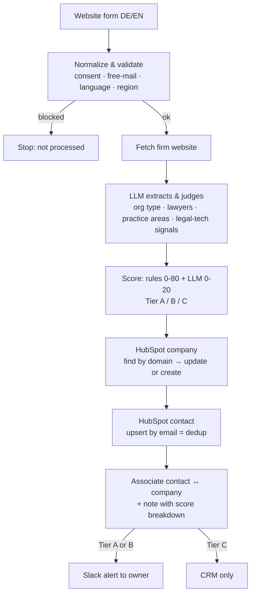

# Inbound Lead Enrichment & Routing Engine (n8n + HubSpot)

An n8n workflow that turns a website form submission into a scored, routed lead. It checks the lead, reads the company's website with an LLM, scores the fit against an ICP for the legal market (law firms, in-house legal teams, legal publishers), writes everything to HubSpot, and alerts the right person in Slack.

It is built for a DACH go-to-market team: German/English detection, a GDPR consent gate, and region-based routing (DACH vs. rest of EU).

> **Status: MVP.** One workflow, all settings in a single Config node. The [roadmap](#roadmap) lists what the full engine adds.

## How it works



| Step | What happens |
| --- | --- |
| Intake | Webhook answers `200` immediately so the form never hangs. |
| Guardrails | Leads without explicit GDPR consent, with an invalid email or a free-mail domain (gmail, gmx, web.de …) stop here. |
| Language & region | DE/EN detected from the message; region from the country field, then the email TLD. |
| Enrichment | The homepage is fetched and an LLM (temperature 0, JSON mode) returns structured fields. It is told never to invent numbers. |
| Scoring | Deterministic rules plus a bounded LLM judgment, so every score is explainable. |
| CRM | HubSpot company found by domain or created; contact upserted by email, so a returning lead updates the same record. |
| Routing | Owner per region from Config; a HubSpot note holds the full score breakdown; Tier A/B leads ping Slack. |
| Failure handling | If the website or the LLM fails, the lead is still saved, scored on rules only and flagged for manual review. |

## ICP scoring (0–100)

| Criterion | Points |
| --- | --- |
| Org type: law firm / in-house legal / publisher | 20 / 20 / 10 |
| Number of lawyers: 50+ / 10–49 / 3–9 | 20 / 15 / 5 |
| Document-heavy practice areas (corporate, M&A, litigation, employment …); any other area | 15; 5 |
| Legal-tech maturity signals: 2+ / 1 | 15 / 8 |
| Region: DACH / rest of EU | 10 / 5 |
| LLM fit judgment, with a one-line reason | 0–20 |

**Tier A** ≥ 70 · **Tier B** ≥ 40 · **Tier C** below 40. Weights and thresholds are illustrative and live in the Config node, so they can be tuned without touching the logic.

## Repository

```
workflow/inbound-lead-engine-mvp.json   n8n workflow export (import this)
scripts/build_workflow.py               generates the export from readable JS + node layout
tests/simulate_code_nodes.js            runs the Code nodes outside n8n with mocked inputs
test-payloads/                          sample form submissions
```

## Setup (about 20 minutes)

1. **Import:** in n8n, *Workflows → Import from File* → `workflow/inbound-lead-engine-mvp.json`.
2. **HubSpot:** create a Private App (*Settings → Integrations → Private Apps*) with scopes `crm.objects.contacts.read/write` and `crm.objects.companies.read/write`. In n8n, add a **HubSpot App Token** credential and select it on every `HubSpot:` node.
3. **OpenAI:** add an **OpenAI** credential and select it on *LLM Extract & Judge*.
4. **Slack:** create an Incoming Webhook and paste its URL into `slack_webhook_url` in the **Config** node.
5. **Config:** set owner names, optional `hubspot_owner_id`s and your `hubspot_portal_id` (for record links in Slack).
6. **Optional:** create contact properties `icp_score` (number), `icp_tier`, `icp_reason`, `lead_language` (text) and set `write_custom_properties: true`.

## Testing

**Offline (no credentials needed):**

```bash
node tests/simulate_code_nodes.js
```

Covers: Tier A routing, EU/English routing, the consent and free-mail block, LLM failure fallback, returning-contact detection and Tier C (no Slack).

**End to end:** open the Webhook node, click *Listen for test event*, then send a payload. Use a sandbox HubSpot account.

```bash
curl -X POST "http://localhost:5678/webhook-test/lead-intake" \
  -H "Content-Type: application/json" \
  --data @test-payloads/tier-a-law-firm.json
```

The sample payloads use placeholder domains. To see enrichment work, replace the domain in the email with a real firm's website, and keep the person clearly fake ("Test Lead").

## Design decisions

- **Rules plus LLM, not LLM only.** Rules make the score explainable and stable; the LLM adds the judgment that rules cannot express, and it is capped at 20 points.
- **The LLM extracts, the rules decide.** The model returns facts in a fixed JSON schema; points are assigned in code.
- **Never block on enrichment.** A failed website fetch or LLM call degrades to rules-only scoring plus a review flag, so no lead is lost.
- **HubSpot does the dedup.** Upsert by email avoids duplicates without custom matching logic; companies are matched by domain.
- **One Config node.** Every tunable value sits in one place, which later becomes database tables.

## Roadmap

- [ ] Store and nurture no-consent leads instead of stopping
- [ ] Existing-customer check: expansion alert to the account owner instead of a BDR
- [ ] Segment routing (law firm vs. in-house) and round-robin within a team
- [ ] AI-drafted first-touch email in the lead's language, approved from Slack
- [ ] Postgres funnel log and SQL dashboard: lead volume, qualification rate, speed-to-lead, meeting → opportunity
- [ ] Scoring weights and routing rules moved from Config into database tables
