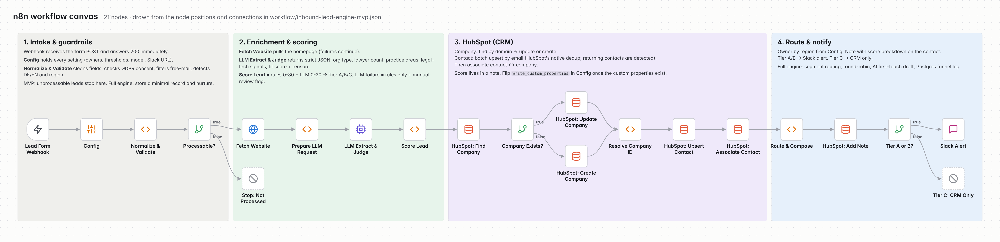

# Architecture

One n8n workflow, 21 nodes, four stages. Each stage is a sticky-note group on the canvas.

## Input contract

The webhook expects a JSON `POST` to `/webhook/lead-intake`:

| Field | Required | Notes |
| --- | --- | --- |
| `email` | yes | Lower-cased; the domain is taken from it |
| `consent` | yes | Only `true`, `"true"`, `"on"`, `"yes"`, `"ja"`, `"1"` count as consent |
| `first_name`, `last_name` | no | |
| `company` | no | Falls back to the email domain |
| `country` | no | ISO-2 code; used for region before the email TLD |
| `message` | no | Used for language detection and sent to the LLM |

## Node reference

| # | Node | Type | What it does | On failure |
| --- | --- | --- | --- | --- |
| 1 | Lead Form Webhook | Webhook | Receives the form and answers `200` at once | — |
| 2 | Config | Code | Returns every setting: owners, tier thresholds, model, Slack URL, country and free-mail lists | — |
| 3 | Normalize & Validate | Code | Cleans fields, checks email and consent, filters free-mail, detects language and region | — |
| 4 | Processable? | IF | `false` → stop | — |
| 5 | Fetch Website | HTTP | `GET https://<domain>`, 10 s timeout | Continues; enrichment marked incomplete |
| 6 | Prepare LLM Request | Code | Strips HTML to ~6,000 characters of text and builds the prompt | — |
| 7 | LLM Extract & Judge | HTTP → OpenAI | Chat Completions, `temperature: 0`, JSON mode | Continues; rules-only score |
| 8 | Score Lead | Code | Rules + LLM points → total → tier; builds HubSpot payloads | — |
| 9 | HubSpot: Find Company | HTTP | `POST /crm/v3/objects/companies/search` on `domain` | Execution stops |
| 10 | Company Exists? | IF | Routes to update or create | — |
| 11 | HubSpot: Update Company | HTTP | `PATCH /crm/v3/objects/companies/{id}` | Execution stops |
| 12 | HubSpot: Create Company | HTTP | `POST /crm/v3/objects/companies` | Execution stops |
| 13 | Resolve Company ID | Code | Merges both branches into one `company_id` | — |
| 14 | HubSpot: Upsert Contact | HTTP | `POST /crm/v3/objects/contacts/batch/upsert` with `idProperty: email` | Execution stops |
| 15 | HubSpot: Associate Contact | HTTP | `PUT /crm/v4/objects/contact/{id}/associations/default/company/{id}` | Execution stops |
| 16 | Route & Compose | Code | Picks the owner, builds the note and the Slack message, detects returning contacts | — |
| 17 | HubSpot: Add Note | HTTP | `POST /crm/v3/objects/notes`, associated to the contact | Execution stops |
| 18 | Tier A or B? | IF | `false` → CRM only | — |
| 19 | Slack Alert | HTTP | Posts to a Slack incoming webhook | Execution stops |
| 20–21 | Stop / CRM Only | No-op | End points that make the branches visible | — |

Enrichment failures are tolerated on purpose: a lead must never be lost because a website was slow. CRM failures are not tolerated: if HubSpot rejects a write, the execution fails visibly in n8n so it can be retried.

## Why the code lives in Code nodes

Logic sits in five small Code nodes rather than in dozens of Set/IF nodes. That keeps the canvas readable and makes the logic testable: `tests/harness.js` runs the same JavaScript outside n8n, with the HTTP calls mocked.

The workflow export is generated by `scripts/build_workflow.py`, so the JavaScript stays readable in one file and the JSON is never edited by hand.

## Known limitations of the MVP

- **Homepage only.** Many firms list lawyers and practice areas on subpages; the LLM sees only the homepage, so lawyer counts are often `null`.
- **JavaScript-heavy sites** return little text to a plain HTTP fetch. Those leads are scored on rules only and flagged for review.
- **Language detection is a keyword heuristic.** Good enough for DE vs. EN form messages; it would need a library for more languages.
- **HubSpot search indexing lags** a few seconds behind writes, so two submissions from the same new domain within seconds can create two companies.
- **The webhook is unauthenticated.** In production it would sit behind a header secret or the form provider's signature check.
- **Routing is by region only.** Segment routing and round-robin are on the roadmap.
